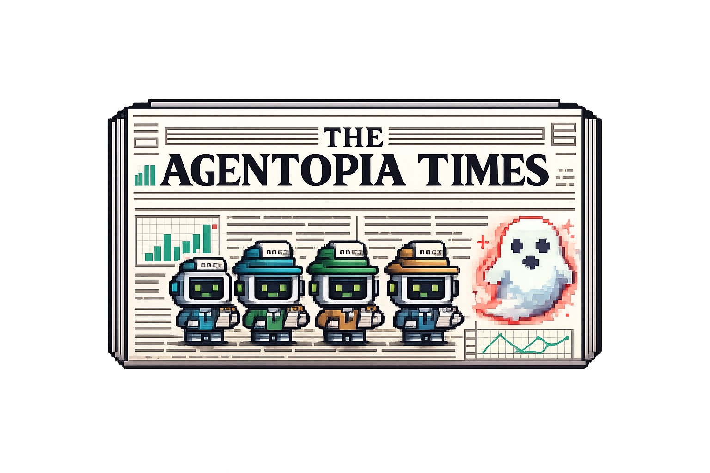

<p align="center">
  
</p>

<h1 align="center">The Agentopia Times</h1>
<h3 align="center">Understanding and Mitigating Hallucinations in Multi-Agent LLM Systems via Data Journalism Gameplay</h3>

<p align="center">
  <a href="https://visual-intelligence-umn.github.io/The-Agentopia-Times/"></a>
  <a href="https://www.youtube.com/watch?v=kv6urb4J95c"></a>
  <a href="https://github.com/Visual-Intelligence-UMN/The-Agentopia-Times"></a>
</p>

---

<p align="center">
  
</p>

<p align="center">
  <em><b>The Agentopia Times:</b> An educational game simulating a newsroom where LLM agents collaborate to create data-driven narratives. Users adjust communication protocols to manage hallucinated content and explore multi-agent system design for hallucination mitigation.</em>
</p>

---

## 📑 Table of Contents

- [📖 Overview](#-overview)
    - [✨ Key Features](#-key-features)
- [🎮 Demo: Gameplay Examples](#-demo-gameplay-examples)
- [👥 Team](#-team)
- [🚀 Getting Started](#-getting-started)
    - [⚙️ Prerequisites](#️-prerequisites)
    - [📦 Installation](#-installation)
    - [▶️ Run Locally](#️-run-locally)
    - [🔑 Configure an OpenAI API Key](#-configure-an-openai-api-key)
- [📜 License](#-license)

---

## 📖 Overview

**The Agentopia Times** is an educational game that teaches multi-agent system (MAS) design for hallucination mitigation through active experimentation. The game simulates a newsroom where LLM agents collaborate to create data-driven narratives, with users tasked to adjust communication protocols to manage hallucinated content.

### ✨ Key Features

- **Newsroom Simulation**: Experience how LLM agents collaborate in a familiar data journalism context
- **Interactive MAS Design**: Adjust communication protocols and coordination strategies to manage hallucinated content
- **Structured Learning**: Mapping between MAS concepts and familiar gameplay mechanics with immediate feedback
- **No Installation**: Runs directly in web browsers—play and learn online
- **Hallucination Exploration**: Understand propagation patterns and refine strategies through two use cases

---

## 🎮 Demo: Gameplay Examples

<table>
  <tr>
    <td></td>
    <td></td>
  </tr>
  <tr>
    <td align="center">
      <b>Configuring MAS Strategies</b><br/>
      <sub>
        Users can assign different strategies (e.g., Sequential, Voting, or Single-Agent) to each newsroom room, determining how LLM agents collaborate to complete tasks and validate results.
      </sub>
    </td>
    <td align="center">
      <b>Viewing Reports</b><br/>
      <sub>
        Users can inspect intermediate and final reports, including outputs from each room and individual agents throughout the workflow.
      </sub>
    </td>
  </tr>
</table>

---

## 👥 Team

Yilin Lu, Shurui Du, Qianwen Wang

---

## 🚀 Getting Started

### ⚙️ Prerequisites

- Git
- Node.js 22 (the version in `.nvmrc`) and npm

### 📦 Installation

```bash
git clone https://github.com/Visual-Intelligence-UMN/The-Agentopia-Times.git
cd The-Agentopia-Times
npm ci
```

### ▶️ Run Locally

From the repository root, start the Vite development server.

```bash
npm run start
```

Vite opens the game in your browser. You can also open the URL printed in the terminal, usually [http://localhost:5173](http://localhost:5173).

### 🔑 Configure an OpenAI API Key

To play with live LLM agents, create a key on the [OpenAI API Keys page](https://platform.openai.com/api-keys), then set it in the game menu or in a local environment file.

**Game menu.** Paste the key into the main menu and click **Start Game**. Once the key is verified, the browser saves it for later visits at the same local URL.

**Local environment file.** Create `.env.local` in the repository root next to `package.json` and replace the placeholder with your key.

```dotenv
VITE_OPENAI_API_KEY=sk-your-key-here
```

If Vite is already running, stop it and run `npm run start` again, then reload the page. A key already saved in the browser takes precedence. To switch to the key in `.env.local`, delete the `openai-api-key` entry from the site's local storage and reload.

Use this file for local development only. Vite includes `VITE_` variables used by the app in the browser bundle. Remove the key from `.env.local` before building for distribution. See the [Vite environment variable guide](https://vite.dev/guide/env-and-mode).

---

## 📜 License

This project is licensed under the MIT License. Please see the [LICENSE](LICENSE) file for details.